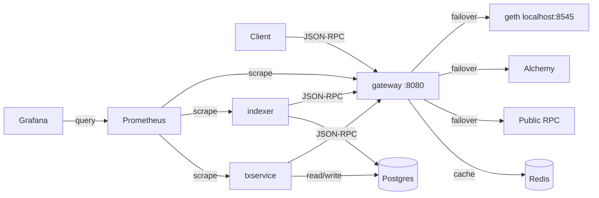

# mini-exchange-backend

迷你交易所的链上后端 — 运行在以太坊 Hoodi 测试网 (chainId 560048) 上的三个服务。

## 架构



## 服务

| 服务 | 语言 | 说明 |
|------|------|------|
| [gateway](gateway/) | Go | 区块链 JSON-RPC 网关：多上游故障切换、感知最终确认的缓存、按 API key 限流 |
| [indexer](indexer/) | Go | 链上事件索引器：扫描 ERC-20 Transfer 事件，断点续扫，reorg 检测与回滚 |
| [txservice](txservice/) | Java / Spring Boot | 交易发送服务：模拟交易所提现，幂等请求，nonce 管理，卡单替换 |
| [contracts](contracts/) | Solidity / Foundry | ERC-20 代币合约（基于 OpenZeppelin），部署到 Hoodi |

## 快速开始

### 前置条件

- Go 1.26+
- Java 27+
- Docker & Docker Compose
- Foundry (`forge`)
- 本机运行的 geth + Lighthouse（Hoodi 测试网）

### 启动基础设施

```bash
cp .env.example .env
# 编辑 .env 填入你的 Alchemy URL 和私钥

make up          # 启动 Postgres, Redis, Prometheus, Grafana
```

### 构建与测试

```bash
make build       # 构建所有服务
make test        # 运行所有测试
make lint        # 代码检查
```

### 逐个服务

```bash
# gateway
cd gateway && go run ./cmd/gateway

# indexer
cd indexer && go run ./cmd/indexer

# txservice
cd txservice && ./gradlew bootRun

# contracts
cd contracts && forge build && forge test
```

## 监控

- Prometheus: http://localhost:9090
- Grafana: http://localhost:3000 (admin/admin)

## License

[MIT](LICENSE)
